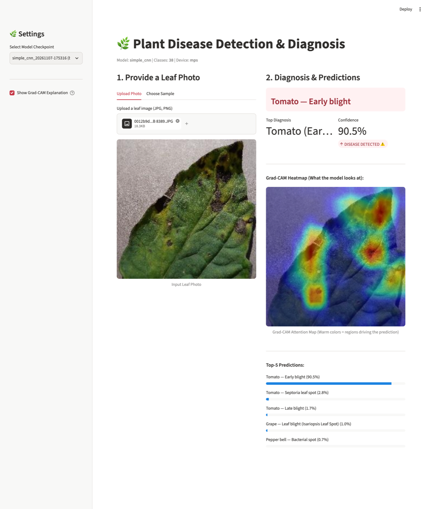

# Plant Disease Detection (PlantVillage)

A farmer takes a photo of a leaf and the model says which plant it is and whether it has a disease (e.g. *Tomato — Early blight*).
Dataset: [mohanty/PlantVillage](https://huggingface.co/datasets/mohanty/PlantVillage) — 54,306 leaf photos, 14 crops, 26 diseases, 38 classes.

Three architectures, one pipeline:

| Config | Model | Idea |
|---|---|---|
| `configs/simple_cnn.yaml` | SimpleCNN (1.18 M params) | small CNN we build ourselves, trained from scratch |
| `configs/resnet18.yaml` | ResNet-18 (11.2 M) | transfer learning from ImageNet |
| `configs/efficientnet_b0.yaml` | EfficientNet-B0 (4.0 M) | transfer learning from ImageNet |

The full explanation of the project, the CNN, filters and kernel calculations is in **[`docs/PROJECT_EXPLAINED.md`](docs/PROJECT_EXPLAINED.md)**.



---

## Results

Evaluated once on the held-out, leaf-grouped test set (5,508 colour images, 38 classes):

| Model | Params | Accuracy | Top-3 accuracy | Macro-F1 | Weighted-F1 |
|---|---|---|---|---|---|
| **ResNet-18** (ImageNet transfer learning) | 11.2 M | **99.58 %** | 99.95 % | **99.29 %** | **99.58 %** |
| SimpleCNN (trained from scratch) | 1.18 M | 99.29 % | **99.98 %** | 98.13 % | 99.25 % |

ResNet-18 is best overall. SimpleCNN comes very close with about 10× fewer parameters, which makes it attractive for mobile or edge devices. EfficientNet-B0 has a config but has not been trained yet.

## Pretrained models

The trained checkpoints are attached to the [**v1.0 release**](https://github.com/sesha003/Plant-Disease-Detection-Diagnosis/releases/tag/v1.0), so you can run the app without training:

```bash
mkdir -p runs/resnet18 runs/simple_cnn
curl -L -o runs/resnet18/best.pt   https://github.com/sesha003/Plant-Disease-Detection-Diagnosis/releases/download/v1.0/resnet18_best.pt
curl -L -o runs/simple_cnn/best.pt https://github.com/sesha003/Plant-Disease-Detection-Diagnosis/releases/download/v1.0/simple_cnn_best.pt

streamlit run app/streamlit_app.py
```

Each checkpoint contains the weights, class names and config, so nothing else is needed. The app picks up any `runs/**/best.pt` automatically.

---

## Project structure

```
plant-disease-detection/
├── configs/
│   ├── default.yaml            # shared settings (data, augmentation, training)
│   ├── simple_cnn.yaml         # each model config inherits default.yaml
│   ├── resnet18.yaml
│   └── efficientnet_b0.yaml
├── src/plantdx/
│   ├── data.py                 # HF download, leaf-grouped splits, leakage check, transforms, loaders
│   ├── models.py               # SimpleCNN + pretrained ResNet / EfficientNet
│   ├── train.py                # training loop, early stopping, checkpoints, curves
│   ├── evaluate.py             # accuracy, F1, top-k, confusion matrix, per-crop results
│   ├── predict.py              # predict one image or a folder
│   ├── visualize.py            # classic kernels, learned filters, feature maps, Grad-CAM
│   ├── export.py               # ONNX / TorchScript / mobile export
│   └── utils.py                # config loading, seeding, device, logging
├── scripts/
│   ├── download_data.py        # fetch the dataset once
│   ├── run_all_experiments.sh  # train + evaluate all models
│   └── compare_runs.py         # results table across runs
├── app/streamlit_app.py        # small web demo
├── tests/test_pipeline.py      # end-to-end test on synthetic data (no internet needed)
├── docs/
│   ├── PROJECT_EXPLAINED.md    # full walkthrough: dataset, CNN, kernels, training
│   └── images/                 # README screenshots
├── requirements.txt
└── pyproject.toml
```

---

## Setup

```bash
git clone https://github.com/sesha003/Plant-Disease-Detection-Diagnosis.git
cd Plant-Disease-Detection-Diagnosis
python -m venv .venv && source .venv/bin/activate      # Windows: .venv\Scripts\activate
pip install -r requirements.txt
pip install -e .                                        # makes `python -m plantdx.*` work anywhere
```

(Without `pip install -e .` you can use `export PYTHONPATH=$PWD/src` instead.)

## Quick start

```bash
# 1. download (one time, ~2.2 GB zip; only the 'color' images are extracted)
python scripts/download_data.py --variant color

# 2. quick sanity run on 10 % of the leaves
python -m plantdx.train --config configs/simple_cnn.yaml --set data.fraction=0.1 train.epochs=3

# 3. full runs
python -m plantdx.train --config configs/simple_cnn.yaml
python -m plantdx.train --config configs/resnet18.yaml
python -m plantdx.train --config configs/efficientnet_b0.yaml

# 4. compare
python scripts/compare_runs.py
```

Each run creates `runs/<model>_<timestamp>/` with:

```
best.pt  last.pt  config.yaml  class_names.json  history.csv  curves.png  train.log
eval_test/  metrics.json  classification_report.txt  confusion_matrix.png
            per_crop_accuracy.csv  top_confusions.csv
```

### Override any setting from the command line

```bash
python -m plantdx.train --config configs/resnet18.yaml \
    --set data.variant=segmented data.batch_size=32 train.epochs=5 data.class_weighting=true
```

## After training

```bash
RUN=runs/resnet18_20261106-210000          # your run folder

python -m plantdx.evaluate  --checkpoint $RUN/best.pt                        # test-set report
python -m plantdx.predict   --checkpoint $RUN/best.pt --image leaf.jpg --topk 3
python -m plantdx.visualize kernels     --image leaf.jpg
python -m plantdx.visualize filters     --checkpoint $RUN/best.pt
python -m plantdx.visualize featuremaps --checkpoint $RUN/best.pt --image leaf.jpg
python -m plantdx.visualize gradcam     --checkpoint $RUN/best.pt --image leaf.jpg
python -m plantdx.export    --checkpoint $RUN/best.pt --format all           # ONNX + TorchScript
streamlit run app/streamlit_app.py -- --checkpoint $RUN/best.pt              # web demo
```

## Docker Deployment

The image copies `runs/` into the container, so first train a model or download the [pretrained models](#pretrained-models). Then build and run the Streamlit app container with Docker Compose:

```bash
docker compose up --build -d
```

Or using standard Docker CLI:

```bash
docker build -t plant-disease-app .
docker run -d -p 8501:8501 --name plant-disease-container plant-disease-app
```

Then visit [http://localhost:8501](http://localhost:8501) in your browser.

## Google Colab

```python
!git clone -q https://github.com/sesha003/Plant-Disease-Detection-Diagnosis.git
%cd Plant-Disease-Detection-Diagnosis
!pip install -q -r requirements.txt && pip install -q -e .
!python scripts/download_data.py --variant color --data-dir /content/pv --delete-zip
!python -m plantdx.train --config configs/resnet18.yaml --set data.data_dir=/content/pv data.num_workers=2
```

Runtime → Change runtime type → GPU. On a T4, expect several minutes per epoch for ResNet-18 on the full colour set (image loading is often the bottleneck, so try `data.num_workers=2` to `4`). To keep checkpoints, set `output_dir` to a mounted Google Drive folder (`--set output_dir=/content/drive/MyDrive/plantdx_runs`).

## Test the pipeline

```bash
pytest -q tests/
```

Builds a tiny fake dataset with the same folder/split/leaf-map layout as the real one and runs training → evaluation → prediction → visualisation → export end-to-end on CPU.

---

## Design notes

- **No leakage.** Photos of the same physical leaf never end up in two splits: the official train/test split is leaf-grouped, the validation set is carved out of train *by leaf*, and `check_no_leakage` stops the run if any leaf id is shared.
- **Why not `datasets.load_dataset`?** The Hub repo relies on a loading script, which `datasets` ≥ 4.0 no longer runs. `data.py` downloads the same files with `huggingface_hub` and reproduces the script's logic, so it works with any version.
- **Model selection on validation macro-F1**, not accuracy — the classes are imbalanced, and macro-F1 drops if any class is handled badly. The test set is evaluated once, with the best checkpoint.
- **Transfer learning warm-up.** Pretrained models train only the new classification head for the first epoch (`freeze_backbone_epochs`), then fine-tune everything with a small learning rate.

## Citation

Mohanty, S. P., Hughes, D. P., & Salathé, M. (2016). *Using deep learning for image-based plant disease detection.* Frontiers in Plant Science, 7, 1419. Dataset licence: CC BY-SA 3.0.
